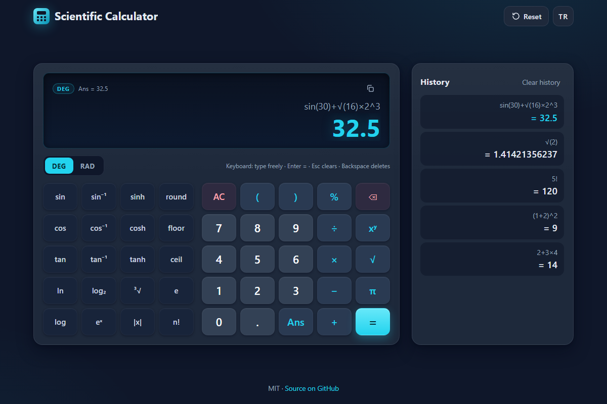

# Scientific Calculator - a fast, keyboard-friendly scientific calculator with its own parser, no eval

[](#tests)
[](LICENSE)

**▶ Play now: https://celaldrg.github.io/calculator/**



## Features

- Own tokenizer and recursive-descent parser - no `eval`, no `Function` constructor.
- Operator precedence, right-associative `^` (`2^3^2 = 512`), unary minus (`-2^2 = -4`), postfix `%` and `!`.
- Implicit multiplication: `2π`, `2(3)`, `(1+2)(3+4)`, `3sin(30)`; missing closing parentheses are closed for you.
- Functions: `sin cos tan asin acos atan sinh cosh tanh ln log log2 sqrt √ cbrt abs exp round floor ceil`, constants `π`/`pi` and `e`, and `Ans` (last result).
- DEG/RAD angle mode (`sin(30)` = 0.5 in DEG, `sin(180)` = 0 exactly).
- Results rounded to 12 significant digits (`0.1+0.2` shows `0.3`), exponent notation for very large or small numbers.
- Clear error messages: division by zero, syntax error with its position (highlighted), unknown function, domain error, overflow.
- Live preview while you type, history of the last 50 calculations (saved in your browser), copy-result button.
- English and Turkish interface, dark theme, works on phones and desktops, honours reduced motion.

## How to play

**Touch / mouse:** tap the keys. On narrow screens the scientific functions sit behind the **fn** button. Tap **DEG/RAD** to switch angle mode, tap a history entry to load it again, and use the copy icon to copy the result.

**Keyboard:**

| Key | Action |
| --- | --- |
| `0-9` `.` `,` | digits and decimal point |
| `+` `-` `*` `/` `^` | operators (shown as `+ − × ÷ ^`) |
| `(` `)` `!` `%` | parentheses, factorial, percent |
| letters | function names, `pi`, `e`, `Ans` (e.g. type `sqrt(2)`) |
| `Enter` or `=` | evaluate |
| `Backspace` | delete the last character or function name |
| `Escape` / `Delete` | clear (AC) |

Right after a result, typing an operator continues from `Ans`; typing a digit starts a new expression. **Reset** in the header also sets `Ans` back to 0.

## Run locally

Any static file server works, for example:

```sh
npx serve .
```

Then open the printed `http://` address. ES modules need `http://`, so opening `index.html` via `file://` will not work.

## Tests

```sh
node --test
```

No dependencies. The suite (node:test, deterministic, well under a second) covers:

- the done criterion: `2+3*4 = 14`, `(1+2)^2 = 9`, `sin(30) = 0.5` in DEG mode, `1/0` returns a division-by-zero error (also pressed through the keypad);
- precedence, right-associative powers, unary minus, factorial, percent, implicit multiplication, auto-closed parentheses, constants, every function, DEG/RAD, `Ans`, display rounding and exponent notation, every error code with its position;
- the calculator state machine (preview, history limit, backspace units, continuing from `Ans`), the keyboard mapping, the keypad layout, storage with a broken `localStorage`, and that every English string has a Turkish twin;
- source rules: no `eval`, `Function`, `innerHTML` or `console.log` in `src/`.

## Project structure

```
index.html            page shell, meta tags, favicon
style.css             dark theme, responsive layout
src/
  tokenizer.js        text -> tokens
  parser.js           tokens -> syntax tree (recursive descent)
  evaluator.js        syntax tree -> number
  functions.js        functions, constants, DEG/RAD trig
  format.js           12-digit display formatting
  errors.js           error codes
  engine.js           calculate(expression, options)
  calculator.js       calculator state (typing, =, Ans, history, demo state)
  history.js          history helpers
  keys.js             keyboard -> action mapping
  layout.js           keypad layout (data)
  i18n.js             English and Turkish strings
  storage.js          safe localStorage wrapper
  ui.js               DOM rendering
  main.js             wiring: events, storage, language
test/                 node:test suites
docs/screenshot.png   README screenshot (?demo)
```

## License

[MIT](LICENSE) © 2026 Celalettin Durgaç

---

## Türkçe

Kendi ayrıştırıcısı olan, `eval` kullanmayan, klavye dostu bilimsel hesap makinesi.

**▶ Hemen oyna: https://celaldrg.github.io/calculator/**

### Özellikler

- Kendi sözcük çözümleyicisi (tokenizer) ve özyinelemeli iniş ayrıştırıcısı - `eval` ve `Function` yapıcısı yok.
- İşlem önceliği, sağdan birleşen `^` (`2^3^2 = 512`), tekli eksi (`-2^2 = -4`), sonek `%` ve `!`.
- Örtük çarpma: `2π`, `2(3)`, `(1+2)(3+4)`, `3sin(30)`; kapanmayan parantezler otomatik kapatılır.
- Fonksiyonlar: `sin cos tan asin acos atan sinh cosh tanh ln log log2 sqrt √ cbrt abs exp round floor ceil`, `π`/`pi` ve `e` sabitleri, `Ans` (son sonuç).
- DEG/RAD açı birimi (DEG'de `sin(30)` = 0,5; `sin(180)` tam olarak 0).
- Sonuçlar 12 anlamlı basamağa yuvarlanır (`0.1+0.2` → `0.3`); çok büyük/küçük sayılar üslü gösterilir.
- Anlaşılır hata mesajları: sıfıra bölme, konumu işaretlenen sözdizimi hatası, bilinmeyen fonksiyon, tanım kümesi hatası, taşma.
- Yazarken canlı önizleme, son 50 hesaplamanın geçmişi (tarayıcıda saklanır), sonucu kopyalama düğmesi.
- İngilizce ve Türkçe arayüz, koyu tema, telefonda ve masaüstünde çalışır, azaltılmış hareket tercihine uyar.

### Nasıl oynanır

**Dokunmatik / fare:** tuşlara dokunun. Dar ekranlarda bilimsel fonksiyonlar **fn** düğmesinin arkasındadır. Açı birimini **DEG/RAD** ile değiştirin, bir geçmiş kaydına dokunarak yeniden yükleyin, kopyala simgesiyle sonucu kopyalayın.

**Klavye:**

| Tuş | İşlev |
| --- | --- |
| `0-9` `.` `,` | rakamlar ve ondalık ayırıcı |
| `+` `-` `*` `/` `^` | işleçler (`+ − × ÷ ^` olarak gösterilir) |
| `(` `)` `!` `%` | parantez, faktöriyel, yüzde |
| harfler | fonksiyon adları, `pi`, `e`, `Ans` (ör. `sqrt(2)` yazın) |
| `Enter` veya `=` | hesapla |
| `Backspace` | son karakteri ya da fonksiyon adını sil |
| `Escape` / `Delete` | temizle (AC) |

Bir sonuçtan hemen sonra işleç yazarsanız hesap `Ans` ile devam eder; rakam yazarsanız yeni ifade başlar. Üst bardaki **Sıfırla** düğmesi `Ans` değerini de 0 yapar.

### Yerelde çalıştırma

Herhangi bir statik dosya sunucusu yeterli, örneğin:

```sh
npx serve .
```

Ardından yazdırılan `http://` adresini açın. ES modülleri `http://` gerektirir; `index.html` dosyasını `file://` ile açmak çalışmaz.

### Testler

```sh
node --test
```

Bağımlılık yok. Testler (node:test, deterministik, bir saniyenin altında) şunları kapsar: bitti ölçütü (`2+3*4 = 14`, `(1+2)^2 = 9`, DEG'de `sin(30) = 0,5`, `1/0` sıfıra bölme hatası; tuş takımından basılarak da), işlem önceliği, üs, tekli eksi, faktöriyel, yüzde, örtük çarpma, otomatik parantez, tüm fonksiyonlar, DEG/RAD, `Ans`, gösterim yuvarlaması, tüm hata kodları; hesap makinesi durumu, klavye eşlemesi, tuş düzeni, bozuk `localStorage` ile depolama, İngilizce/Türkçe metin eşleşmesi ve `src/` içinde `eval`, `Function`, `innerHTML`, `console.log` bulunmaması.

### Lisans

[MIT](LICENSE) © 2026 Celalettin Durgaç
